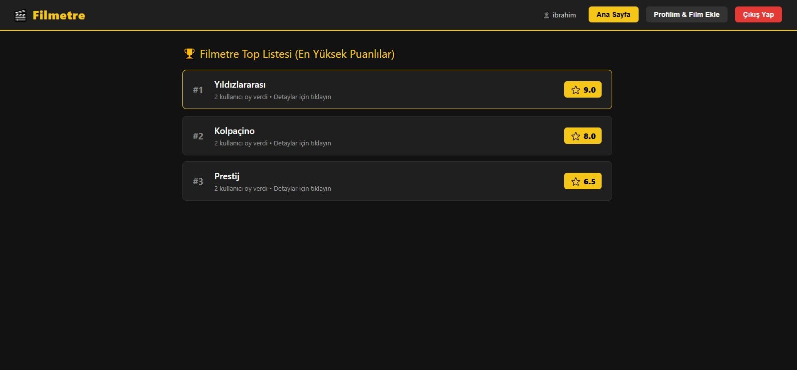

# 🎬 Filmetre - Kişisel IMDb ve Film Puanlama Uygulaması

**Filmetre**, kullanıcıların üye olup izledikleri filmleri profillerine ekleyebildikleri, 1 ile 10 arasında puan verebildikleri ve tüm kullanıcıların verdiği puanların ortalamasıyla dinamik bir "Top Film Listesi" oluşturan modern bir web uygulamasıdır (SPA).

🌐 Canlı Demo: [https://filmetre.vercel.app]

## 📸 Ekran Görüntüsü



## 🚀 Özellikler

- **Kullanıcı Girişi & Kayıt (Auth):** Kullanıcı adı ve şifre ile kayıt olma ve oturum açma.
- **Dinamik Ortalama & Sıralama:** Ana sayfada tüm filmlerin genel puan ortalamasına göre en yüksekten en düşüğe doğru sıralanması.
- **Film Detay Görünümü:** Herhangi bir filme tıklandığında o filme hangi kullanıcının kaç puan verdiğinin (yüksekten düşüğe) listelenmesi.
- **Kişisel Profil & Film Ekleme:** Kullanıcının kendi izlediği filmleri görmesi, sistemde var olan bir filmi seçip puanlaması veya listede yoksa yeni film eklemesi.
- **Kalıcı Veri (LocalStorage):** Sunucu gereksinimi olmadan tüm kullanıcı, film ve puan verilerinin tarayıcı hafızasında (`LocalStorage`) saklanması.

## 🛠️ Kullanılan Teknolojiler

- **Önyüz (Frontend):** React.js (Hooks: `useState`, `useEffect`)
- **Kurulum ve Derleme Aracı:** Vite
- **Stil ve Tasarım:** Saf CSS3 (IMDb esintili Koyu Tema & Altın Sarısı Arayüz, Responsive Grid/Flexbox yapı)
- **Veri Saklama:** Web Storage API (`LocalStorage`)

## 💻 Kurulum ve Çalıştırma Adımları

Projeyi kendi bilgisayarınızda çalıştırmak için aşağıdaki adımları izleyebilirsiniz:

1. Depoyu klonlayın veya ZIP olarak indirin:
   ```bash
   git clone [https://github.com/edustad/filmetre](https://github.com/edustad/filmetre)

2. Proje klasörüne gidin:
    Bash
    cd filmetre

3. Gerekli bağımlılıkları yükleyin:
    Bash
    npm install

4. Geliştirme sunucusunu başlatın:
    Bash
    npm run dev

5. Tarayıcınızda verilen localhost (örn:http://localhost:5173)  adresine giderek uygulamayı görüntüleyin.
